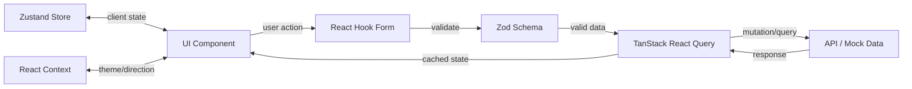

# Shadcn Admin — Architecture Reference

## Component Dependency Graph

```mermaid
graph TD
    Root["__root.tsx"]
    Root --> NavigationProgress
    Root --> Outlet
    Root --> Toaster
    Root --> DevTools["DevTools (dev only)"]
    
    Outlet --> AuthRoutes["(auth)/ routes"]
    Outlet --> ErrorRoutes["(errors)/ routes"]
    Outlet --> AuthenticatedLayout["_authenticated/route.tsx"]
    Outlet --> ClerkRoutes["clerk/ routes"]
    
    AuthRoutes --> SignIn
    AuthRoutes --> SignIn2["Sign In 2-Col"]
    AuthRoutes --> SignUp
    AuthRoutes --> ForgotPwd["Forgot Password"]
    AuthRoutes --> OTP
    
    ErrorRoutes --> E401["401 Unauthorized"]
    ErrorRoutes --> E403["403 Forbidden"]
    ErrorRoutes --> E404["404 Not Found"]
    ErrorRoutes --> E500["500 Server Error"]
    ErrorRoutes --> E503["503 Maintenance"]
    
    AuthenticatedLayout --> AppSidebar
    AuthenticatedLayout --> Header
    AuthenticatedLayout --> Main
    
    AppSidebar --> TeamSwitcher
    AppSidebar --> NavGroup
    AppSidebar --> NavUser
    
    Header --> TopNav
    Header --> Search
    Header --> ThemeSwitch
    Header --> ProfileDropdown
    
    Main --> DashboardPage["Dashboard (index)"]
    Main --> TasksPage["Tasks"]
    Main --> UsersPage["Users"]
    Main --> AppsPage["Apps"]
    Main --> ChatsPage["Chats"]
    Main --> SettingsPage["Settings"]
    Main --> HelpCenter["Help Center"]
```



## Data Flow Pattern



## Feature Module Pattern

Each feature in `src/features/` follows this convention:

```
features/<name>/
├── components/
│   ├── <name>-columns.tsx          # TanStack Table column definitions
│   ├── <name>-table.tsx            # Table wrapper component
│   ├── <name>-dialogs.tsx          # Dialog state coordinator
│   ├── <name>-mutate-drawer.tsx    # Create/Edit drawer (React Hook Form + Zod)
│   ├── <name>-delete-dialog.tsx    # Delete confirmation
│   ├── <name>-provider.tsx         # Context provider for dialog state
│   ├── <name>-primary-buttons.tsx  # Top action buttons (Add, Import, etc.)
│   ├── data-table-row-actions.tsx  # Per-row action dropdown
│   └── data-table-bulk-actions.tsx # Multi-select bulk actions
├── data/
│   ├── schema.ts                   # Zod schemas + TypeScript types
│   ├── data.ts                     # Filter options, enums, labels
│   └── <name>.ts                   # Mock/seed data
└── index.tsx                       # Main page component (exported)
```

## Route Structure

TanStack Router uses file-based routing with these conventions:
- `__root.tsx` — Root layout
- `(group)/` — Route group (no URL segment)
- `_layout/` — Layout route (wraps children)
- `$param` — Dynamic parameter
- `index.tsx` — Index route for directory

### Protected Route Guard

`_authenticated/route.tsx` acts as the auth guard:
- Checks auth state from Zustand store
- Redirects to `/sign-in` if unauthenticated
- Wraps all child routes with `AuthenticatedLayout` (sidebar + header)

## Shadcn UI Components Used (30+)

### Core Primitives
alert, alert-dialog, avatar, badge, button, calendar, card, checkbox, collapsible, command, dialog, dropdown-menu, form, input, input-otp, label, popover, radio-group, scroll-area, select, separator, sheet, sidebar, skeleton, sonner, switch, table, tabs, textarea, tooltip

### Customized (DO NOT overwrite via CLI)
- **Modified:** scroll-area, sonner, separator
- **RTL Updated:** alert-dialog, calendar, command, dialog, dropdown-menu, select, table, sheet, sidebar, switch

## Key Contexts

| Context | Location | Purpose |
|---|---|---|
| `ThemeProvider` | `src/context/` | Light/dark/system theme |
| `FontProvider` | `src/context/` | Font family config |
| `SearchProvider` | `src/context/` | Global search state |
| `DirectionProvider` | `src/context/` | LTR/RTL direction |
